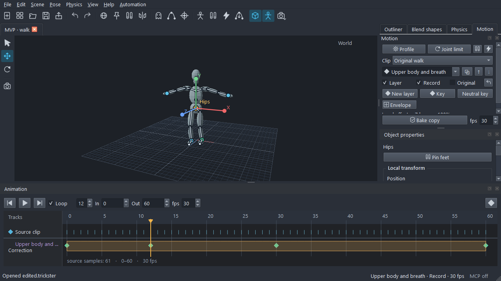

# Trickster

An open-source character animation editor built with C++17 and Qt 6 Widgets. Import FBX/glTF, pose with FK/IK, edit curves and correction layers, and export animation. MIT licensed.

**[Download for Windows x64](https://github.com/Atmosaero/Trickster/releases/latest)** - extract the complete ZIP and run `Trickster.exe`. No development tools are required.

Start with **Scene > Choose scene > Templates**, or open your own character. Select a bone, pose with **W / E**, insert keys with **I**, play with **Space**, save with **Ctrl+S**, and export with **Ctrl+Shift+E**. The editor starts empty. Try the [walk, jump and hand demos](docs/DEMOS.md).

[Motion editing](docs/MOTION.md) - [Curves and analysis](docs/MOTION_ANALYSIS.md) - [Notes](docs/NOTES.md) - [MCP](docs/MCP.md)

Physics tools use native MuJoCo and remain experimental: 62 scientific acceptance gates are open. See the [physics guide](docs/PHYSICS.md) and [scope of validation](docs/PHYSICS_RELIABILITY.md).

For development, see [Building](docs/BUILD.md), [Testing](docs/TESTING.md), [Architecture](docs/ARCHITECTURE.md), [Roadmap](docs/ROADMAP.md) and [Changelog](CHANGELOG.md). Dependency notices are in [THIRD_PARTY.md](THIRD_PARTY.md).
